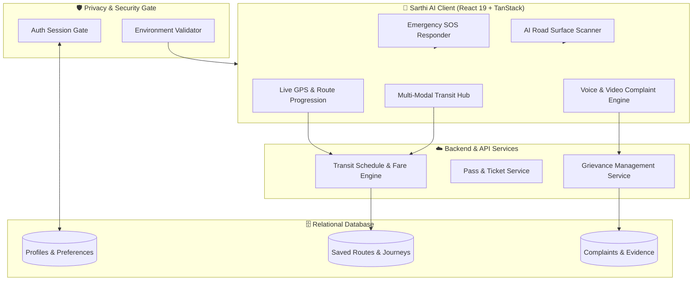

<p align="center">
  
</p>

<h1 align="center">Sarthi AI</h1>
<h3 align="center">Smart Multi-Modal Transit, Booking & Navigation Platform</h3>

<p align="center">
  <strong>An intelligent, mobile-first public transportation and mobility platform designed for urban commuters. Unifies local trains, express rail, city buses, and auto-rickshaws with real-time tracking, live road anomaly detection, AI complaint logging, emergency SOS, and ticketing.</strong>
</p>

<p align="center">
  
  
  
  
  
</p>

---

## 📑 Table of Contents

- [Overview](#-overview)
- [System Architecture & Workflow](#-system-architecture--workflow)
- [Core Features](#-core-features)
- [Tech Stack](#-tech-stack)
- [Project Structure](#-project-structure)
- [Getting Started](#-getting-started)
  - [Prerequisites](#prerequisites)
  - [Installation](#1-clone--install-dependencies)
  - [Environment Configuration](#2-environment-setup)
  - [Backend Setup (Bring Your Own Backend)](#3-backend-setup)
  - [Running the App](#4-run-development-server)
  - [Production Build](#5-build-for-production)
- [Security & Privacy](#-security--privacy)

---

## 🚆 Overview

Commuting through bustling metropolitan transit systems involves navigating multiple disjointed travel modes: local suburban trains, express corridors, metro lines, public buses, and local auto-rickshaws. **Sarthi AI** unifies these disparate services into a singular, responsive platform.

### Key Value Highlights:
1. **Multi-Modal Transit Hub**: Seamlessly switch between Local Trains (Western, Central, Harbour), Metro lines, Buses, and Auto-rickshaws with unified fare estimations and schedules.
2. **AI Road Scan**: Real-time camera-based computer vision scanner that detects road surface anomalies such as potholes, traffic congestion, waterlogging, and road blockages.
3. **Smart Complaint Desk**: File official transit grievances using text, voice notes (speech-to-text), or photo/video evidence.
4. **Emergency SOS & Safety**: One-tap emergency dispatch with instant SMS/call triggers and emergency contact broadcasting.
5. **Live Tracking & Digital Passes**: Real-time route progression tracking and paperless digital travel passes.

---

## 📊 System Architecture & Workflow



---

## ✨ Core Features

| Feature | Description | Highlight |
| :--- | :--- | :--- |
| 🚊 **Unified Transit Engine** | Multi-mode schedule finder covering suburban rail, metro, bus networks, and auto services. | Complete cross-city route planning |
| 📹 **AI Road Scan** | Live camera anomaly detector for potholes, waterlogging, blockages, and traffic slowdowns. | Community-driven infrastructure alerts |
| 🎙️ **Voice & Media Grievance** | Multi-input complaint filing using voice recordings, typed descriptions, or uploaded photos/videos. | Automated tracking ticket generation |
| 🚨 **Emergency SOS** | High-priority safety hub with quick emergency dialing and location broadcasting. | Rapid response security features |
| 🎫 **Digital Travel Passes** | Instant booking flow for single-journey and period commuter passes. | Zero paper waste, instant QR verification |
| 🧭 **AI Transit Assistant** | Interactive conversational guide to plan journeys and answer transit queries. | Hands-free voice assistance |

---

## 🛠️ Tech Stack

- **Core Framework**: [React 19](https://react.dev/) + [TanStack Router](https://tanstack.com/router)
- **Bundler & Build Tool**: [Vite 7](https://vitejs.dev/) + TypeScript
- **Styling**: [Tailwind CSS v4](https://tailwindcss.com/) with custom design tokens and theme variables
- **UI Primitives**: [Radix UI](https://www.radix-ui.com/) accessible primitives + Lucide Icons
- **Voice & Media Capabilities**: Web Speech API (`SpeechRecognition` + `SpeechSynthesis`) + MediaDevices API
- **Notifications**: Sonner Toasts
- **Database / Backend**: Decoupled architecture ready for connection with Supabase (PostgreSQL + RLS) or any custom backend

---

## 📁 Project Structure

```text
ai-sarthi/
├── public/                     # Static assets, icons, and banners
│   ├── banner.jpg              # Full-width presentation banner
│   └── ...
├── src/
│   ├── assets/                 # Brand illustrations and transportation icons
│   ├── components/             # Reusable UI widgets and layout modules
│   │   ├── ui/                 # Accessible Radix UI components (Dialog, Drawer, Table...)
│   │   └── ...
│   ├── hooks/                  # Custom business and utility hooks (useAuth, useMobile...)
│   ├── integrations/           # Backend adapters (Supabase client & middleware)
│   ├── lib/                    # Helper utilities and formatters
│   ├── routes/                 # TanStack file-based routes
│   │   ├── __root.tsx          # App shell, navigation providers
│   │   ├── index.tsx           # Home transit hub (Bus, Auto, Train)
│   │   ├── auth.tsx            # Commuter authentication
│   │   ├── scan.tsx            # AI road scan camera view
│   │   ├── complaints.tsx      # Grievance registration & history
│   │   ├── emergency.tsx       # SOS emergency dispatch view
│   │   ├── tickets.tsx         # Digital passes & bookings
│   │   ├── track.tsx           # Real-time transit tracking
│   │   └── _authenticated/     # Gated account, dashboard, and assistant routes
│   ├── router.tsx              # Router initialization & error handling
│   └── styles.css              # Tailwind v4 theme styles
├── .env.example                # Environment variables template
├── package.json                # Project dependencies and scripts
├── tsconfig.json               # TypeScript compiler config
└── vite.config.ts              # Vite configuration
```

---

## 🚀 Getting Started

Follow these steps to set up and run Sarthi AI locally.

### Prerequisites

- [Node.js](https://nodejs.org/) (version **18.x** or higher, recommended **20+**)
- `npm`, `pnpm`, or `bun` package manager

### 1. Clone & Install Dependencies

```bash
git clone https://github.com/dipzz0/Sarthi-AI.git
cd Sarthi-AI
npm install
```

### 2. Environment Setup

Copy the sample environment template:

```bash
cp .env.example .env
```

Open `.env` and fill in your backend credentials:

```env
# Backend / Database Configuration (e.g. Supabase)
VITE_SUPABASE_URL="https://your-project.supabase.co"
VITE_SUPABASE_PUBLISHABLE_KEY="your-anon-publishable-key"
SUPABASE_URL="https://your-project.supabase.co"
SUPABASE_PUBLISHABLE_KEY="your-anon-publishable-key"
```

### 3. Backend Setup

This frontend is designed to be completely decoupled. You can connect it to your own **Supabase** instance or custom database backend:

<details>
<summary><strong>Click to view required database schema (SQL)</strong></summary>

```sql
-- Profiles
create table public.profiles (
  id uuid primary key references auth.users on delete cascade,
  full_name text,
  phone text,
  home_city text default 'Mumbai',
  preferred_mode text default 'train',
  concession text default 'none',
  emergency_contact_name text,
  emergency_contact_number text,
  notify_delays boolean not null default true,
  notify_offers boolean not null default false,
  created_at timestamptz not null default now()
);

-- Saved Journeys
create table public.saved_journeys (
  id uuid not null default gen_random_uuid() primary key,
  user_id uuid not null references auth.users on delete cascade,
  origin text not null,
  destination text not null,
  mode_summary text,
  total_minutes integer,
  total_fare integer,
  legs jsonb not null default '[]'::jsonb,
  created_at timestamptz not null default now()
);

-- Complaints & Grievances
create table public.complaints (
  id uuid not null default gen_random_uuid() primary key,
  user_id uuid not null references auth.users on delete cascade,
  ticket_no text not null unique default ('MMB-' || upper(substr(replace(gen_random_uuid()::text,'-',''),1,8))),
  category text not null,
  authority text,
  subject text not null,
  description text not null,
  vehicle_no text,
  location text,
  status text not null default 'submitted',
  created_at timestamptz not null default now()
);
```

</details>

---

### 4. Run Development Server

```bash
npm run dev
```

Open your browser and navigate to `http://localhost:5173` to explore Sarthi AI!

### 5. Build for Production

```bash
npm run build
npm run preview
```

---

## 🔒 Security & Privacy

- **On-Device Road Scanning**: Video frames analyzed during road surface scans are processed locally on the commuter's device, protecting passenger privacy.
- **On-Demand Sensor Permissions**: Camera, microphone, and geolocation access are requested strictly on demand and are never activated in the background.
- **Native Web Speech Privacy**: Voice interaction relies exclusively on browser-native APIs without third-party audio recording trackers.
- **End-to-End Encrypted Transport**: All communication between client applications and backend endpoints occurs exclusively over secure HTTPS/TLS protocols.
